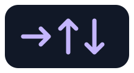

<p align="center"></p>
<p align="center"></p>
<p align="center"><a href="LICENSE"></a>   </p>
<p align="center"></p>

## 🧭 Overview
Explore async iteration, incremental values, early generator closure, and finally-block cleanup. This small project uses built-in language features and does not contact external services.

## ✨ Features
- 🔁 Compare async for with manual anext calls
- 🧹 Observe cleanup when a generator is closed early
- 🧪 Run bounded examples with no third-party packages

## 🎬 Demo
Run the command below and compare the printed lifecycle events. No hosted demo is claimed.

## 🚀 Quick Start
```bash
python async_generator_lab.py --scenario all
```

## 🧰 Tech Stack
- 🧩 Python
- 🔒 Local execution
- 📦 No third-party runtime dependencies

## 🗂️ Folder Structure
```text
python-async-generator-lab/
├── assets/mark.svg
├── async_generator_lab.py
├── test_async_generator_lab.py
├── pyproject.toml
├── .gitignore
├── LICENSE
└── README.md
```

## 🛣️ Roadmap
- [ ] Add more guided edge-case scenarios
- [ ] Add an optional structured JSON report

## 🤝 Contributing
Issues and pull requests are welcome. Include a reproducible example and keep the standard-library-first approach.

## 📄 License
Released under the [MIT License](LICENSE).

<p align="center"></p>